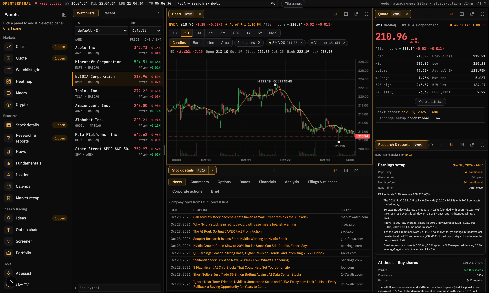

<div align="center">

# OpenTerminal

**A Terminal‑style workspace for the rest of us — built on market data you're allowed to use.**

Dark. Dense. Keyboard‑driven. Runs on your machine with your own Alpaca market‑data keys.

[](#tech-stack)
[](#license)
[](#data-sources)
[](#contributing)

<a href="https://trendshift.io/repositories/215916?utm_source=trendshift-badge&utm_medium=badge&utm_campaign=badge-trendshift-215916" target="_blank" rel="noopener noreferrer"></a>

<br/>



<sub>⭐ If this is useful to you, consider starring the repo — it genuinely helps other people find it.</sub>

</div>

<br/>

## Why OpenTerminal?

Real trading terminals cost **$2,000+ a month**. Most retail dashboards either lock the good stuff behind a paywall or run on a single flaky data source that breaks the moment you actually need it.

OpenTerminal takes a different approach: it combines **Alpaca's market‑data API** (real‑time US stocks, options, crypto and news) with **official public sources** (SEC EDGAR, FRED, the ECB, FINRA, BLS, BEA, the Fed) and, optionally, **Financial Modeling Prep** for fundamentals and earnings, into one fast, keyboard‑first, widget‑based dashboard that runs entirely on your machine. Only sources whose terms allow this kind of automated use are called.

<br/>

## ✨ Features

- 🖥️ **Widget-based workspace** — drag, resize, add, and remove panels (`react-grid-layout`); your layout is saved locally and restored on reload
- ⌘K **global command palette** — instantly search stocks, ETFs, and crypto and jump straight to them
- 📈 **Professional charting** (via [`lightweight-charts`](https://github.com/tradingview/lightweight-charts)) — candlesticks, bars, line, area, volume, 8 timeframes (1D → MAX), and SMA / EMA / VWAP / Bollinger Bands / RSI / MACD indicators, each with a live hover legend showing OHLC, volume, and every active indicator's value under your cursor
- 💹 **Quote panel** — last / bid / ask / OHLC, volume, market cap, P/E, EPS, dividend yield, 52‑week range, beta, shares outstanding
- 📰 **News feed** — Benzinga headlines through Alpaca News, per‑symbol or global
- 🔎 **Large‑cap screener** — filter the S&P 500 and Nasdaq‑100 by sector, market cap, % change, and volume, sortable on every column
- 🗺️ **Live sector heatmap** — treemap sized by market cap, colored by daily % change, refreshing every few seconds
- ⛓️ **Options chain** — calls and puts side‑by‑side with strike, bid/ask, volume, implied volatility, greeks, and ITM highlighting
- 🪙 **Crypto board** — top assets with 7‑day sparklines, BTC/ETH dominance, and full OHLCV charting for any listed coin
- 🏦 **Macro dashboard** — live US Treasury yield curve, VIX, and major index/commodity proxies
- 💼 **Portfolio tracker** — log buy/sell transactions, track average cost, realized & unrealized P&L (persisted in SQLite)
- 📅 **Calendar** — the next two weeks of official US releases (FOMC, CPI, jobs, GDP and more) from the agencies' own schedules, with forecast, previous and actual from FMP when keyed; plus a per‑watchlist earnings calendar (FMP) with click‑through history showing forecast vs. actual EPS for the last several quarters and the stock's next‑day price move
- 🤖 **AI assistant** (optional) — ask questions about the symbol you're looking at, powered by Claude, fully context‑aware of the terminal's current data
- ⚡ **Near real‑time updates** — quotes and indexes refresh every second with a subtle flash on change, so you always know what just moved
- ⌨️ **Keyboard shortcuts** everywhere — `⌘K` to search, `⌥1`–`⌥9` to add any widget

<br/>

## 📸 A closer look

### Charting

Candlesticks, bars, line, or area — 8 timeframes, six technical indicators, and a live legend under your cursor showing OHLC, volume, and every active indicator's value for the candle you're pointing at.


<br/>

### Live sector heatmap

The US large caps (S&P 500 and Nasdaq‑100) as a treemap — sized by market cap, colored by daily % change, refreshing every few seconds so nothing you're watching ever goes stale.


<br/>

### Crypto

Top assets with 7‑day sparklines and BTC/ETH dominance — click through to full OHLCV candlestick charting for any listed coin, same charting engine as stocks.


<br/>

### News

Headlines aggregated and de‑duplicated across multiple sources, filterable per‑symbol or global, so you're never digging through five tabs to catch up.


<br/>

## 🗂️ Data sources

Every source below allows automated use under its terms. Results are cached with a stale‑while‑revalidate strategy, so a temporary outage doesn't blank out the UI.

| Data | Source | Fallback / notes |
|---|---|---|
| Quotes (US stocks/ETFs) | Alpaca live stream + snapshots | FMP (if keyed) → Stooq |
| Quote fields (name, market cap, P/E, EPS, beta, 52w, div yield) | FMP (if keyed) | Without FMP: name/exchange from the Nasdaq Trader symbol directory, shares outstanding from SEC EDGAR (market cap = shares × price); P/E, EPS, beta, 52w and dividend yield are empty |
| Crypto quotes, candles, order book | Alpaca crypto (`BTC`, `ETH`, or any `XXX-USD` pair) | — |
| Crypto board | CoinGecko | — |
| VIX | FRED | — |
| FX (`EURUSD=X` …) | ECB reference rates (daily) | — |
| Foreign listings, other indices | FMP (if keyed) | Stooq |
| Historical candles | Alpaca bars (US stocks, crypto) | FMP (if keyed) → Stooq |
| Symbol search | Nasdaq Trader symbol directories + Alpaca crypto pairs | — |
| Screener / heatmap / sectors | S&P 500 + Nasdaq‑100 (Wikipedia) × Alpaca prices; sector and market cap from FMP (if keyed), else SEC EDGAR (SIC‑derived sector, not GICS) | Europe is not available |
| Options chain | Alpaca options snapshots (OPRA) | Open interest is empty |
| News | Alpaca News (Benzinga) | — |
| Macro (Treasury yields, VIX; euro‑area yields, ECB rate, HICP) | FRED, ECB | — |
| Economic calendar (dates, times) | BLS, BEA, Federal Reserve, EIA; FRED release dates with `FRED_API_KEY` | — |
| Economic calendar (forecast, previous, actual) | FMP (if keyed) | Empty without FMP |
| Earnings calendar and history | FMP (requires `FMP_API_KEY`) | The widget says the key is missing |
| Short volume, insider trades | FINRA, SEC EDGAR | — |

**Removed sources.** Yahoo Finance, TradingView (scanner and search), Nasdaq's public API (`api.nasdaq.com`), Google News and Yahoo RSS, Forex Factory and Binance are no longer used: their terms or robots rules forbid automated access (and Binance blocks US users). Stooq's terms are unclear, so it is only the last price fallback.

> ⚠️ Treat prices as indicative, not execution‑grade. See [`server/src/providers/`](server/src/providers) — each provider is a small, isolated module.

### Keys

| Variable | Unlocks |
|---|---|
| `ALPACA_API_KEY_ID`, `ALPACA_API_SECRET_KEY` | US stock and ETF prices and charts, crypto, options, news, the heatmap, screener and recap. Without them only Stooq prices, FRED/ECB macro, CoinGecko and the official calendars work. |
| `FMP_API_KEY` (optional) | [Financial Modeling Prep](https://site.financialmodelingprep.com/developer/docs): quote fundamentals, foreign listings and indices, FMP sectors and market caps, earnings calendar and history, and forecast/actual values on the economic calendar. FMP's Starter plan covers US listings with annual fundamentals; non‑US exchanges and quarterly data need Premium or above. |
| `FRED_API_KEY` (optional) | Adds FRED's release dates to the economic calendar. |
| `SEC_EDGAR_CONTACT` | Your email, sent in the User‑Agent that SEC EDGAR and BLS require. Without it insider trades, SEC shares/sectors and the BLS schedule are skipped. |

<br/>

## 🚀 Quick start

```bash
git clone https://github.com/ErTasselli/openterminal.git
cd openterminal
npm install
npm run dev
```

- Web UI → **http://localhost:3000**
- API health → **http://localhost:4000/api/status**

Without a `.env` the terminal opens with macro, crypto and the official calendars only. Copy `.env.example` to `.env` and add your Alpaca keys (see [Keys](#keys)) for everything else.

### Optional: Alpaca market data and price history

With an Alpaca market-data subscription, the API keeps its own price history for research and swing studies:

- 10 years of daily bars for every US-listed stock and ETF (about 1–2 GB).
- 2 years of 1-minute bars, including extended hours, for your watchlist, the S&P 500, the Nasdaq-100 and the market/sector ETFs (SPY, QQQ, XLK…). Expect roughly 15–30 GB in `data/minute_bars.db`.
- Prices are split-adjusted. When a split lands, that symbol's history is re-downloaded so it never shows up as a fake swing.
- Delisted symbols are kept (marked inactive) from the day the app first sees them.

Setup:

1. `cp .env.example .env` and fill in `ALPACA_API_KEY_ID` and `ALPACA_API_SECRET_KEY`. `.env` is gitignored. Only Alpaca's market-data API is ever called, never the trading API.
2. Run the first backfill: `npm run history -w server -- all`. It is resumable, so you can stop it and run it again. `npm run history -w server -- status` shows progress.
3. To keep it current on an always-on machine, set `HISTORY_SYNC=1` in `.env`. The API then syncs every weekday after 18:00 New York time. Add `HISTORY_SYNC_MINUTE=0` to keep daily bars only; the sync and `history all` then skip the minute bars.

Every problem in a run is logged as it happens and stored per symbol with its reason for 90 days: `error` (a request failed, with Alpaca's or the network's message), `no_bars` (the request worked but nothing came back, e.g. a typo or a delisted name) and `skipped` (a watchlist ticker that isn't a US stock, such as `^GSPC` or `EURUSD=X`). `npm run history -w server -- issues` lists the latest run's issues; add `--symbol AAPL`, `--kind error` or `--run N` to narrow it. The same list is at `/api/bars/issues`, and `status` shows the counts per run.

The stored bars are served read-only at `/api/bars/daily/:symbol?from=YYYY-MM-DD&to=YYYY-MM-DD`, `/api/bars/minute/:symbol?from=YYYY-MM-DD` and `/api/bars/status`.

**Watchlists.** The watchlist widget holds any number of named lists (pick one from its menu, or New / Del). Import brings in a Webull export (Watchlists → ⋯ → Export, a CSV with every list): each list is saved under its Webull name, replacing a list with the same name and leaving the rest alone. From the command line: `npm run watchlists -w server -- import path/to/webull_watchlists.csv`, and `-- list` to see what is stored. Every symbol on any list gets live prices and minute history.

**Live prices.** With the Alpaca keys set, the API also keeps real-time prices in memory, so clicking a ticker doesn't wait on the web:

- Every trade and quote for the watchlist, S&P 500, Nasdaq-100, sector ETFs and any ticker open on screen (subscribed on the first request, dropped 10 minutes after the last).
- Minute and daily bars for every other US ticker, so they are at most a minute old, plus snapshots every 5 minutes.
- Charts for US tickers come from the stored history plus today's live bar (daily ranges) or Alpaca's intraday bars (1D, 5D, 1M).
- Prices are split by session. The main price, change and change % are the regular session's (09:30–16:00 New York; the close once it's over). Beside them, in the chart header, the quote panel and the watchlist, come **After hours** (16:00–20:00), **Overnight** (20:00–04:00, Sunday to Thursday nights) and **Pre-market** (04:00–09:30): the latest price in each session since the last regular close, with its change from that close. Overnight prices come from Alpaca's Blue Ocean ATS feed (`boats`) on a second stream connection; set `LIVE_OVERNIGHT=0` to leave it off.
- The quote panel shows **● Live** while the regular price moves with every trade, **● As of** a time when it doesn't (stream down, market closed), or the source's name. A green dot next to an extended session means that session is on and live.
- Crypto, VIX, FX, foreign listings, news and options come from the sources in [Data sources](#data-sources). `/api/status` shows the stream's state. Set `LIVE_STREAM=0` to turn it off. Alpaca allows one stream connection per account, so another app using the same keys' stream makes this one fail with error 406.

S&P 500 and Nasdaq-100 membership come from Wikipedia. If either source changes format, put one symbol per line in `data/universe/sp500.txt` or `data/universe/nasdaq100.txt` to override it.

### Optional: AI assistant

```bash
export ANTHROPIC_API_KEY=sk-ant-...
npm run dev
```

Without a key, everything else still works — the AI widget just shows a friendly "unavailable" message instead of failing.

Two optional knobs for the assistant, both standard for the Anthropic SDK:

- `ANTHROPIC_BASE_URL` — point the assistant at an Anthropic-compatible endpoint (a self-hosted gateway, an EU-hosted relay, etc.) instead of api.anthropic.com.
- `ANTHROPIC_MODEL` — override the model sent in requests (default: `claude-opus-4-8`). Required when the endpoint behind `ANTHROPIC_BASE_URL` serves models under different ids.

### Security defaults

- The API and the web app both bind to `127.0.0.1`, and the API only accepts browser requests from `http://localhost:3000` by default — nothing else on your network can reach them out of the box.
- The web app only answers requests addressed to `localhost`, `127.0.0.1` or `[::1]` (this also blocks DNS-rebinding attacks from pages open in your browser), and rejects cross-origin `POST`/`DELETE` requests. Its `/api` proxy attaches the API key to whatever it forwards, so anyone who can use the web app can use the API: treat access to the web app as access to your portfolio data and AI credits.
- The portfolio and AI endpoints require a shared secret. If you don't set `API_KEY` yourself, the API generates one on first run and saves it to `data/.api-key`; the bundled web app reads that file automatically, so local dev stays zero-config.
- To expose this beyond your own machine, set `WEB_PASSWORD=<a-strong-password>` (the browser will prompt for it; any username works) and `WEB_ALLOWED_HOSTS=<hostname you'll browse to>` on the web process, bind it wider (`npm run dev -w web -- -H 0.0.0.0`, or the published port in `docker-compose.yml`), and set `API_HOST=0.0.0.0`, `API_KEY=<a-strong-secret>` (on both the api and web processes), and `WEB_ORIGIN=<your actual origin>` explicitly. The web app refuses non-loopback hosts unless `WEB_PASSWORD` is set. Use HTTPS in front of it, since Basic auth sends the password with every request. Don't do this without also keeping dependencies patched — see [Known limitations](#known-limitations) below.
- To reach it from your phone through a tunnel, keep everything bound to localhost and point the tunnel at port 3000: e.g. `tailscale serve 3000` (private to your tailnet, preferred) or `ngrok http 3000`. Set `WEB_PASSWORD` and add the tunnel's hostname (`<machine>.<tailnet>.ts.net` or your ngrok domain) to `WEB_ALLOWED_HOSTS`. Requests that reach the app through a proxy for a non-local client are treated as remote even if the proxy rewrites `Host` to `localhost`, so they need the password too.
- The `/api/ai` rate limit (10 req/min) keys on `req.ip`. Calls made through the bundled web proxy all arrive from that proxy's own address, so by default every caller sharing it shares one bucket. If you're serving more than one real user through it, set `TRUST_PROXY=1` on the api process **only if** you also run your own reverse proxy in front of the web service that sets `X-Forwarded-For` from the real client and doesn't let visitors set it themselves — otherwise a caller can forge that header to dodge the limit.

<br/>

## 🐳 Docker

```bash
docker compose up --build
```

Portfolio data persists in the `terminal-data` volume (SQLite, WAL mode). Ports are published on `127.0.0.1` only by default; see [Security defaults](#security-defaults) to expose it deliberately.

<br/>

## 🧱 Tech stack

| Layer | Stack |
|---|---|
| Frontend | Next.js 15 · React 19 · TypeScript · Tailwind CSS 4 · Zustand · TanStack Query |
| Charts | `lightweight-charts` (candles/indicators) · D3 (heatmap treemap) · Recharts (yield curve) |
| Backend | Node.js · Express · TypeScript |
| Database | SQLite (`better-sqlite3`, WAL mode) |
| AI | Anthropic Claude (optional) |

<br/>

## 📁 Project structure

```
├── server/                  # Express + TypeScript API
│   └── src/
│       ├── providers/       # alpaca (stocks, crypto, options, news, assets), fmp, sec-reference, secedgar, calendars, fred, ecb, finra, coingecko, stooq
│       ├── routes/          # market (+ market-rows, econ-calendar), portfolio, ai, watchlists, bars
│       ├── cache.ts         # TTL cache with stale-while-revalidate fallback
│       └── db.ts            # SQLite (better-sqlite3, WAL)
└── web/                      # Next.js 15 + React 19 + Tailwind 4
    ├── components/           # TopBar, Sidebar, Workspace, CommandPalette
    ├── components/widgets/   # Chart, Quote, Watchlist, News, Screener, Heatmap, Crypto, Options, Macro, Portfolio, Calendar, AI
    ├── lib/                  # API client, technical indicators
    └── store/                # Zustand store (workspace layout, persisted)
```

Run tests with `npm test` (Vitest, no network calls). CI runs on every push — see [`.github/workflows/ci.yml`](.github/workflows/ci.yml).

<br/>

## 🗺️ Roadmap

- [ ] Chart drawing tools & multi‑asset comparison overlay
- [ ] Black‑Scholes Greeks on the options chain
- [ ] Price alerts with desktop notifications
- [ ] PostgreSQL as an alternative to SQLite

Have an idea? [Open an issue](../../issues) — contributions are very welcome.

<br/>

## 🤝 Contributing

Pull requests are welcome, especially:
- New or more resilient data providers (`server/src/providers/`)
- New widgets (`web/components/widgets/`)
- Bug fixes and UI polish

Please open an issue first for anything non‑trivial so we can align on approach before you invest the time.

<br/>

## Known limitations

- `npm audit` still flags two dependency advisories this project doesn't force-fix: `fast-xml-parser`'s XMLBuilder injection (moderate) doesn't apply here — only `XMLParser` is used, never `XMLBuilder` — and `postcss`'s high-severity issue is bundled inside Next.js itself, only resolved by a Next 16 major upgrade. Both are tracked, neither is silently ignored.
- If you deploy behind a reverse proxy or load balancer, set `API_HOST`/`WEB_ORIGIN` to match, and terminate TLS in front of it — this project doesn't handle HTTPS itself.

<br/>

## ⚖️ Disclaimer

For personal and educational use only. Market data may be delayed, incomplete, or occasionally wrong — **do not use this for real investment decisions**.

This project is not affiliated with, endorsed by, or sponsored by any of the data providers it connects to. It does not host or redistribute data to third parties — it's source code you run yourself, fetching data directly from the provider. Respect the terms of service of the underlying data providers (your Alpaca and FMP subscriptions included); most are licensed for personal use and prohibit redistribution.

## License

[MIT](LICENSE)

<br/>

<div align="center">

**star the repo** ⭐ — it's the best way to support the project.

</div>
